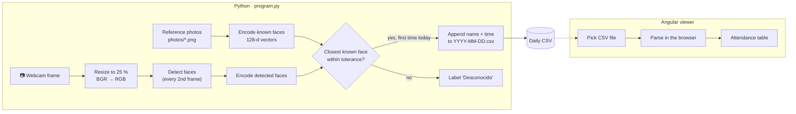

<div align="center">

# 🙂 Face Recognition Attendance System

**Real-time attendance from a webcam: recognises known faces, logs each person once per day to a CSV, and ships with an Angular viewer that reads the log entirely in the browser.**


</div>

<!-- Add a GIF or screenshot of the camera window and the web viewer here -->

---

## At a glance

| | |
|---|---|
| 🧠 **Recognition** | 128-dimensional face embeddings (dlib ResNet) + nearest-neighbour match with a distance threshold |
| ⚡ **Real-time tricks** | Frames downscaled to 25 % (**16× fewer pixels**) and only every other frame analysed |
| 📝 **Output** | One CSV per day (`2026-07-05.csv`), one row per person, written and flushed instantly |
| 🔒 **Privacy** | The web viewer parses the CSV locally: the file is never uploaded anywhere |

## How it works



## Engineering highlights

### Recognition (Python)
- **Embedding-based matching.** Each face becomes a 128-number vector. The system takes the known face at the **smallest distance** (`np.argmin(face_distance)`) and only accepts it if it is also within the match tolerance, so unknown visitors are labelled as such instead of being forced onto the nearest employee.
- **Built for real time on a laptop CPU.** Detection runs on a quarter-size frame and on alternating frames; boxes are scaled back up for display, so the video stays smooth.
- **Exactly-once attendance.** A `pending` set holds who hasn't been seen today; each person is logged once, no matter how long they stand in front of the camera.
- **Crash-safe logging.** The CSV is opened in append mode, gets its header only if empty, and is `flush()`ed after every record. Restarting mid-day continues the same file.
- **Fails loudly and clearly.** Missing photo, a photo with no detectable face, or a camera that can't be opened each raise a specific error with a human-readable message; the camera is always released in a `finally` block.
- **Cross-platform camera access.** Uses the AVFoundation backend on macOS and the default backend elsewhere.

### Viewer (Angular 21)
- **State with Angular Signals** (`signal()`) and the new control-flow syntax (`@if`, `@for`).
- **Hand-written CSV parser** that handles quoted fields, escaped quotes, CRLF line endings and a UTF-8 BOM, and **auto-detects the delimiter** (`,` `;` or tab), so files re-saved from Excel or Numbers still open.
- **Backwards compatible**: logs produced by earlier versions without a header row are detected (time pattern in column 2) and given one.
- **Performance guard**: the table renders the first 1,000 rows of large files.

## Quick start

**Recognition**

```bash
python3 -m venv venv
source venv/bin/activate
python -m pip install -r requirements.txt
python program.py          # press q to quit
```

On macOS, allow camera access for Terminal / VS Code when prompted. To register people, add a photo to `photos/` and its name to the `PEOPLE` dictionary in `program.py`.

**Viewer**

```bash
cd frontend
npm install
npm start                  # http://localhost:4200
```

## Project structure

```text
├── program.py        # Capture → detect → encode → match → log
├── photos/           # One reference photo per known person (demo: public figures)
├── requirements.txt  # face-recognition, opencv-python, numpy
└── frontend/         # Angular 21 attendance viewer (client-side CSV parsing)
```

## Tech stack

| Area | Tools |
|---|---|
| Computer vision | OpenCV, face_recognition (dlib), NumPy |
| Frontend | Angular 21 (standalone components, Signals), TypeScript |
| Storage | CSV (one file per day) |

## Responsible use

Face data is biometric data and is specially protected under the GDPR. A production deployment would need explicit consent, encrypted storage of the reference embeddings and a retention policy. This repository is a technical demo that uses public photos.

---

<div align="center">

Built by **Marcos** · [@mmartinezvaras](https://github.com/mmartinezvaras)

</div>
